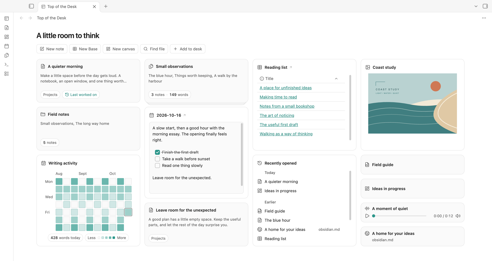
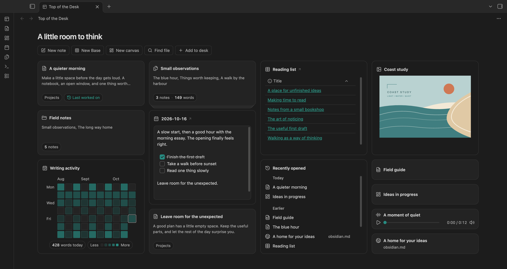

# Top of the Desk

Keep notes, files, websites, and writing tools together on a customizable desk.

Bring the things you’re working on together in Obsidian: a draft, a reading list, today’s note, and the references you keep returning to.

Add notes, folders, Bases, canvases, PDFs, audio, images, and websites. Arrange them your way, group related notes into stacks, and keep a scratchpad close for passing thoughts. Everything stays in its original place in your vault.

Return to recently opened items, continue your daily writing, and see your writing activity—all from your desk.



## Make room for your work

- **Bring your sources together.** Add notes, folders, Bases, canvases, PDFs, audio, images, and websites. Search in **Add to desk**, paste a link, or drag an item from the Files sidebar.
- **Arrange it your way.** Drag a heading to move an item. Resize where it is useful, group related notes into a stack, or keep several tools in one place and switch between them.
- **Keep writing close.** Capture a thought in Scratchpad or write in today's daily note. Both use ordinary Markdown files.
- **Pick up where you left off.** Recently opened brings supported sources together under Today and Earlier, covering the last seven local calendar days. Last worked on takes you back to your most recently edited eligible note.
- **See your writing take shape.** Writing activity shows net words added or removed each day, starting when you enable it.

Notes and folders have short previews. Bases keep their native view. Canvases, PDFs, and websites are compact links; audio includes a small player, and images can have a larger preview.


## Start with a few things

1. Open **Top of the Desk** from the ribbon or the **Open desk** command.
2. Choose **Add to desk**, then select a file or folder. You can also paste a web address and press Enter.
3. Drag headings to arrange the desk. Use **Edit** for names, appearance, and all other actions. Choose and reorder toolbar shortcuts in **Settings → Top of the Desk → Toolbar**. Select Edit alongside other shortcuts, or keep only Edit selected.

Adding an item does not move its source. **Remove from desk** leaves the original file untouched. Items already on the desk stay searchable; selecting one shows you where it is.

[Read the full guide](docs/GUIDE.md) · [Try the demo](demo/README.md) · [See all screenshots](docs/SCREENSHOTS.md)

## Light or dark

The desk follows Obsidian's appearance and accent colour.



## Your files stay yours

Scratchpad and Daily note edit regular Markdown files. Other desk items are references to existing sources. Layout preferences are saved in the plugin's `data.json`; recent history, writing activity, and draft recovery use vault-scoped local Obsidian storage.

Top of the Desk does not fetch website previews or add an external service. Websites open through Obsidian's Web viewer. See [storage and privacy](docs/PRIVACY.md).

## Install manually

Download `main.js`, `manifest.json`, and `styles.css` from the [GitHub release](https://github.com/justgregb/obsidian-top-of-the-desk/releases/latest). Put the three files in `.obsidian/plugins/top-of-the-desk/` inside your vault, then enable **Top of the Desk** in Community plugins. To update, replace those three files and reload the plugin; keep your existing `data.json`.

Version **0.9.66** requires desktop Obsidian **1.14.4 or later**. Release checks were run on macOS with Obsidian 1.14.4; Windows and Linux have not been exercised. Mobile is excluded from this release. It is not yet listed in the Community directory.

## Development

```sh
npm ci
npm run bundle
```

`npm run build` also typechecks; `npm run lint` checks source and CSS, and `npm test` runs 41 automated tests. Desktop integration, settings, and responsive-layout checks are recorded for each release. See [development notes](docs/DEVELOPMENT.md) and the [release checklist](docs/RELEASE-CHECKLIST.md) for verification details.

## License

Released under the [MIT License](LICENSE). See [third-party notices](THIRD-PARTY-NOTICES.md) for embedded-editor attribution.

*Screenshots use the included fictional demo vault. Writing totals and recent history are seeded examples, not measured usage. The interface is captured directly from Obsidian.*
