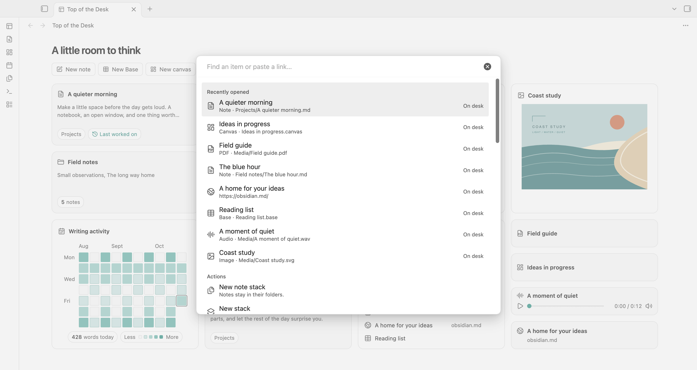
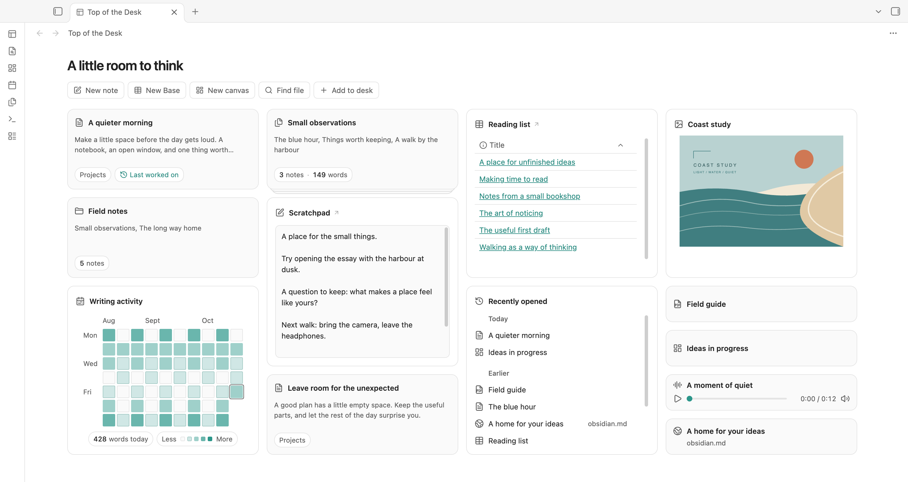

# Screenshots

Captured directly from Top of the Desk 0.9.50 in Obsidian 1.14.4 on macOS. Default Obsidian appearance, teal accent, 1600 × 850 CSS-pixel viewport; PNG captures are 3200 × 1700 on this Mac. No mock interface or post-capture retouching is used.

All notes, artwork, PDF content, and audio are original demo material. Recent history, the Last worked on marker, and activity values are seeded examples. The website entry points to Obsidian's public home page; synthetic history does not imply any particular browsing activity.

## Overview — light


Recommended README hero and first release image.

## Overview — dark


## Note stack


## Add to desk



## Scratchpad



## Recreate on another Mac

Follow [demo setup](../demo/README.md), then run:

```sh
node scripts/capture-demo.mjs "Top of the Desk Demo"
```

The script checks a demo-only marker before mutations, uses the Obsidian CLI, temporarily sets a desktop viewport, switches light/dark appearance, opens the note-stack preview and Add, switches the writing stack, and captures five PNGs. It restores the starting theme/sidebar and clears viewport emulation afterward. It is specific to this plugin version and Obsidian's available CLI interfaces. Do not run it against a personal or synced vault.

When preparing a new demo on a later date, the Daily note and seeded history follow that date. Capture dates and app version are in `images/capture-info.json`. If code, layout, or copy changes, recapture rather than editing the screenshots to suggest behavior the plugin does not have.
